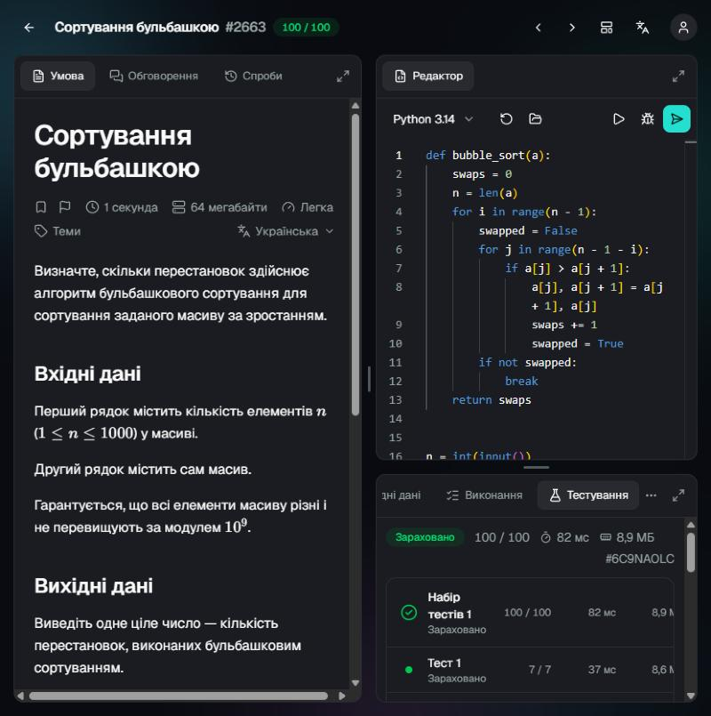
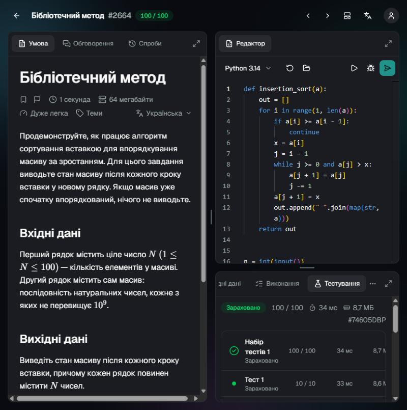
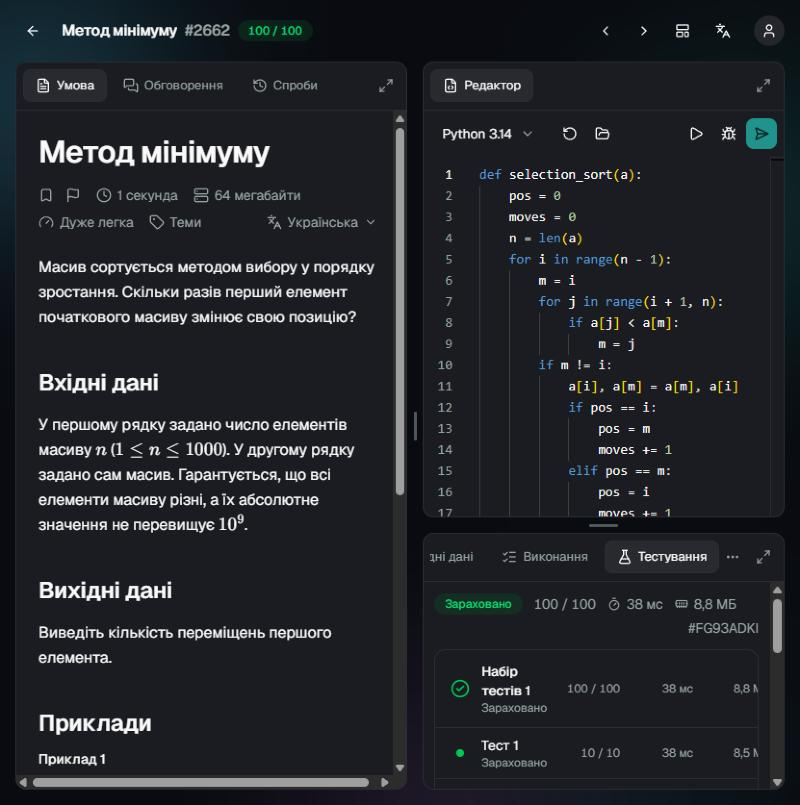
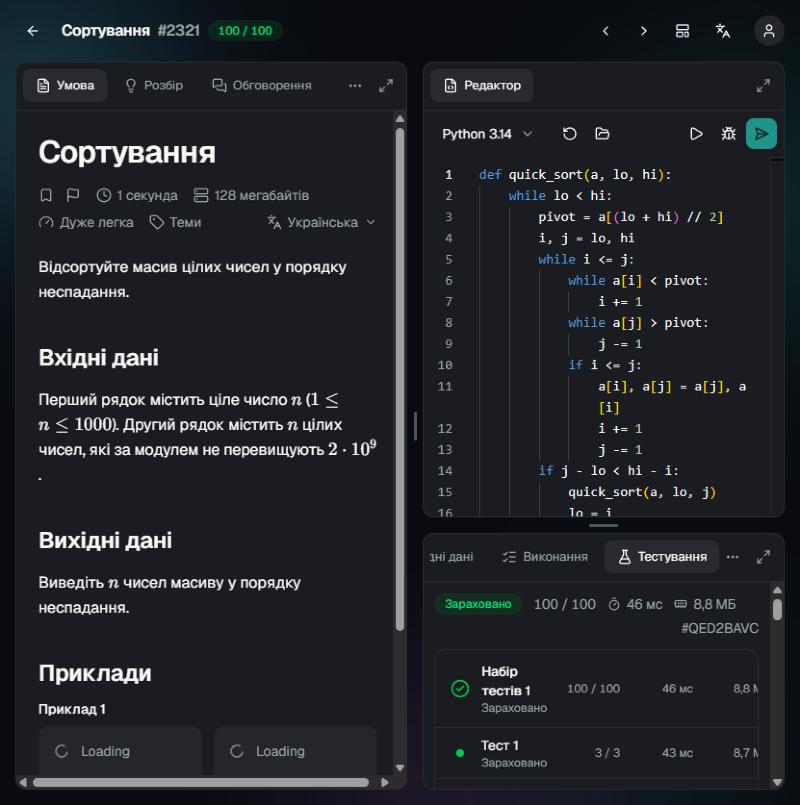
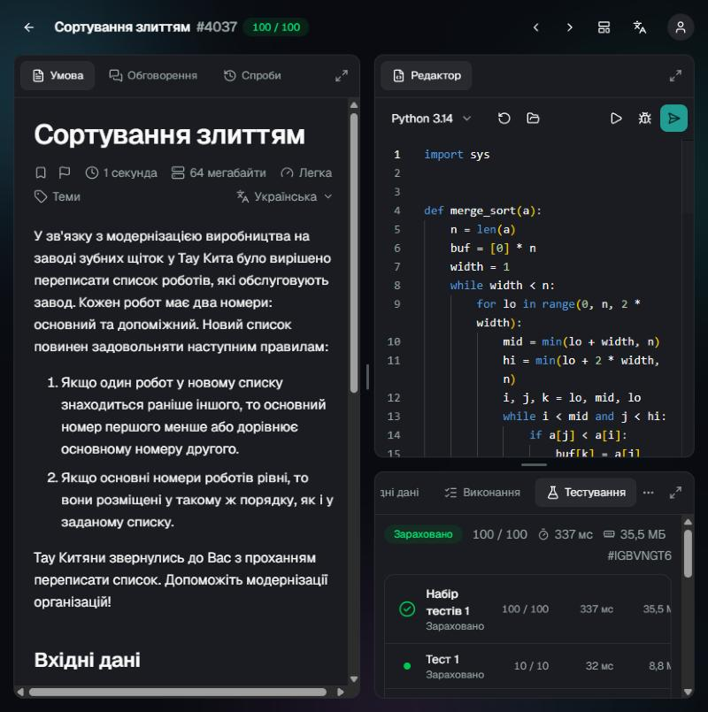

# Алгоритми і структури даних. Лабораторні роботи 8–9. Сортування

У п'яти задачах використано п'ять різних алгоритмів сортування: бульбашкою, вибором, вставкою, швидке сортування та сортування злиттям.

| Задача | Eolymp | Алгоритм | Код | Результат |
|---|---|---|---|---|
| 8.5. Сортування бульбашкою | [2663](https://eolymp.com/uk/problems/2663) | бульбашкою | [t08_05_e2663.py](t08_05_e2663.py) | 100% |
| 8.7. Бібліотечний метод | [2664](https://eolymp.com/uk/problems/2664) | вставкою | [t08_07_e2664.py](t08_07_e2664.py) | 100% |
| 8.12. Метод мінімуму | [2662](https://eolymp.com/uk/problems/2662) | вибором | [t08_12_e2662.py](t08_12_e2662.py) | 100% |
| 9.4. Сортування | [2321](https://eolymp.com/uk/problems/2321) | швидке сортування | [t09_04_e2321.py](t09_04_e2321.py) | 100% |
| 9.5. Сортування злиттям | [4037](https://eolymp.com/uk/problems/4037) | злиттям | [t09_05_e4037.py](t09_05_e4037.py) | 100% |

---

## 8.5. Сортування бульбашкою
Сортуємо масив бульбашкою і рахуємо кількість обмінів сусідніх елементів. Якщо за прохід не було жодного обміну, сортування завершується.

## 8.7. Бібліотечний метод
Сортування вставкою: кожен елемент, менший за попередній, зсуваємо ліворуч на своє місце і після кожної такої вставки виводимо масив.

## 8.12. Метод мінімуму
Сортування вибором: на i-му кроці шукаємо мінімум серед a[i..n−1] і міняємо його з a[i]. Відстежуємо позицію першого елемента початкового масиву і рахуємо, скільки разів він переміщувався.

## 9.4. Сортування
Швидке сортування (схема Хоара): опорний елемент — середній, розбиття двома вказівниками, рекурсія для меншої частини і цикл для більшої.

## 9.5. Сортування злиттям
Висхідне сортування злиттям. Сортування злиттям стійке, тому роботи з однаковим основним номером зберігають початковий порядок. Для швидкодії ключ кодується числом «основний номер · 200000 + індекс».

